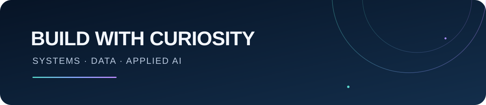



# Hey, I'm Sudeeksh 👋

**Computer Science student · Software builder · Curious problem solver**

I like turning complex ideas into useful software — from systems and databases to applied AI.

[Projects](#selected-projects) · [What I work with](#toolbox) · [Connect](#connect)

---

### A little about me

I learn by building: exploring how software works under the hood, designing reliable data-backed applications, and experimenting with AI that gives useful, evidence-grounded results. I care about clear engineering, thoughtful details, and making projects easy to understand and run.

### Selected projects

| Project | What it explores |
| --- | --- |
| [AisleIQ](https://github.com/sudeeksh02/aisleiq-evidence-grounded-product-discovery) | Evidence-grounded product discovery with hybrid retrieval, hard constraints, and review intelligence. |
| [Incident Intelligence Platform](https://github.com/sudeeksh02/incident-intelligence-platform) | A software engineering project focused on incident intelligence. |
| [DBMS Miniproject](https://github.com/sudeeksh02/DBMS-Miniproject) | A database-backed application built with TypeScript and PostgreSQL. |
| [SWE-EVO](https://github.com/sudeeksh02/SWE-EVO) | A software engineering project developed with a team. |

### Toolbox

**Languages & data:** Python · C · TypeScript · SQL / PostgreSQL  
**Interests:** Applied AI · Systems programming · Databases · Software engineering

### Connect

- GitHub: [@sudeeksh02](https://github.com/sudeeksh02)

*Always learning. Always building.*

